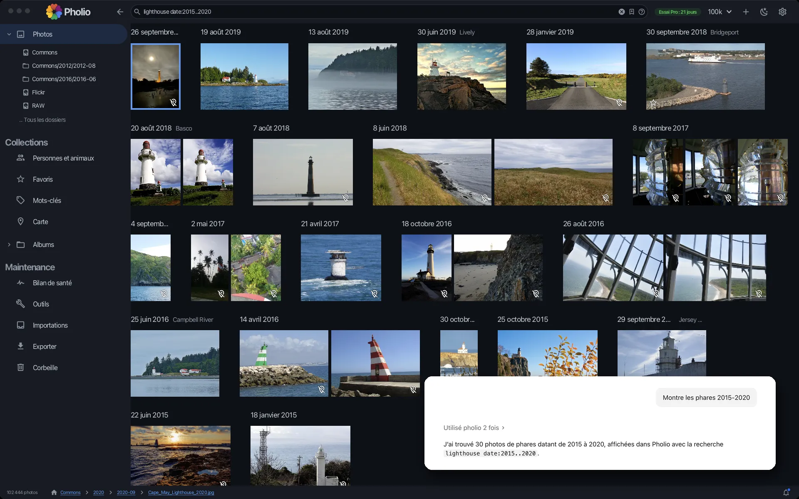

# Pholio

**English** · [Français](README.fr.md)

**Your photos, on your drives, under your control.**

Pholio is a desktop application to organise, browse and search large photo and video collections — tens of
thousands of files — wherever they live: your computer's own disk, USB drives, a NAS or any network share (choose one or a combination, according to your
performance expectation).

[](https://getpholio.ca)

More on the website: **[getpholio.ca](https://getpholio.ca)**

## Download

Installers for **macOS** (Apple Silicon and Intel), **Windows** and **Linux** are attached to each
[release](../../releases/latest).

Latest version: [](../../releases/latest)

| Platform | Download |
|---|---|
| macOS — Apple Silicon (M1 and later) | [pholio-macos-arm64.dmg](https://github.com/Imag-In/Pholio/releases/latest/download/pholio-macos-arm64.dmg) |
| macOS — Intel | [pholio-macos-x64.dmg](https://github.com/Imag-In/Pholio/releases/latest/download/pholio-macos-x64.dmg) |
| Windows 64-bit | [pholio-windows-x64.msi](https://github.com/Imag-In/Pholio/releases/latest/download/pholio-windows-x64.msi) |
| Linux 64-bit (Debian, Ubuntu, …) | [pholio-linux-amd64.deb](https://github.com/Imag-In/Pholio/releases/latest/download/pholio-linux-amd64.deb) |

Older versions, and a checksum for every installer, are on the [releases page](../../releases).

The installers are not signed yet, so your system may warn you the first time you open Pholio:

- **macOS** — drag Pholio to *Applications* and open it once; when macOS refuses, go to *System Settings →
  Privacy & Security* and click *Open Anyway* next to the message about Pholio. On older macOS versions,
  right-clicking the app and choosing *Open* is enough.

  Or, from the Terminal, lift the download quarantine once after installing — this only affects Pholio:

  ```bash
  xattr -dr com.apple.quarantine /Applications/Pholio.app
  ```

- **Windows** — on the "Windows protected your PC" screen, click *More info*, then *Run anyway*.

  Or unblock the downloaded installer before running it — right-click it, *Properties*, tick *Unblock* — or
  from PowerShell (this only affects that file):

  ```powershell
  Unblock-File -Path "$env:USERPROFILE\Downloads\pholio-windows-x64.msi"
  ```

## Main features

Libraries, timeline, search, places, people and pets, duplicates, albums, import from phones and cards, AI
assistants…: see the [features on getpholio.ca](https://getpholio.ca/#fonctionnalites).

## Your files stay yours

Pholio never touches the pictures themselves: no re-encoding, no resizing, no moving or renaming behind your
back. Its own index lives in a separate database.

When you do edit something — a date, a location, a rating, keywords or people — Pholio writes it into the
file using the standard metadata fields every serious photo application understands. That way your work is
not locked into Pholio: another cataloguing tool, today or in ten years, will read the same information.

## Why a desktop application

Pholio is deliberately **not** a cloud service.

Most photo apps today want your pictures uploaded to someone else's servers before you can organise them.
Pholio goes the other way: it works directly on the drives you already own — internal disk, external and USB
drives, NAS, network shares — indexes them properly, and lets you find anything in seconds, offline.

The goal is to take back control of your own photos first. Publishing a selection to the cloud later, when *you* decide to, is welcome — as an extra step, not
as the price of admission.

## A rewrite, with AI

Pholio is the rewrite of an older personal project. This new version was built with heavy help from AI
coding assistants: they wrote a large share of the code, under close direction and review. It is a real-world
experiment in what a single developer can build this way.

## Source available — on Gitea, not here

Pholio's source code is public, but Pholio is **source-available, not open source**: it is licensed under the
[PolyForm Strict License 1.0.0](LICENSE.txt), with [additional permissions](ADDITIONAL-PERMISSIONS.md). You
may use it as is for noncommercial purposes; commercial use, including inside a company, needs a separate
licence from the author.

The code is deliberately **not** published on GitHub. Using AI to help write the code is one thing. Letting
the code be used to train AI models is another, and it should require the author's consent: training,
fine-tuning or evaluating machine-learning models on Pholio is prohibited without it. GitHub's policy on how
hosted repositories may be used for AI training is not clear enough to give that assurance, so this
repository only hosts the installers and the release notes.

The sources live on a self-hosted Gitea instance: https://git.pholio.freeddns.org/Imag-In/pholio. Forks and
pull requests are welcome there — see [CONTRIBUTING.md](CONTRIBUTING.md).

## Report a bug or suggest an idea

[Open an issue](https://github.com/Imag-In/Pholio/issues/new/choose) here on GitHub, with the **Bug report** or
**Idea or request** form. English or French, as you prefer.

## Release notes

Every release comes with its notes, also kept in [`release_note/`](release_note/).

## Credits

Pholio is built on many open source libraries, open recognition models and open map data: see
[CREDITS.md](CREDITS.md) — also available in the application, from the `?` in Settings.
